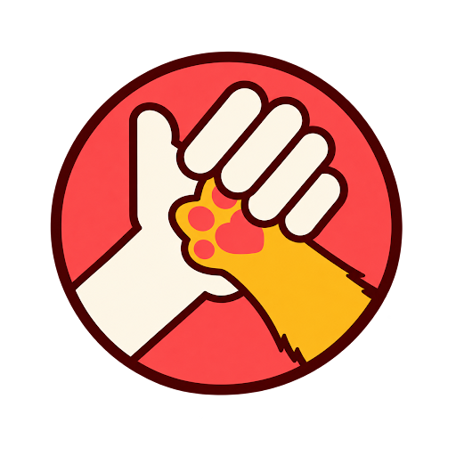

<p align="center">
  
</p>

# 🐾 Dame Tu Pata — Sitio Web Oficial

Plataforma web desarrollada para **Dame Tu Pata**, iniciativa salvadoreña enfocada en rescate, cuidado y adopción responsable de perritos.

🌐 **Sitio web en producción:** [https://dametupatasv.keeycode.com](https://dametupatasv.keeycode.com)

<p align="left">
  <a href="https://astro.build"></a>
  <a href="https://www.typescriptlang.org"></a>
  <a href="https://www.sanity.io"></a>
  <a href="https://tailwindcss.com"></a>
  <a href="https://leafletjs.com"></a>
  <a href="https://vercel.com"></a>
  <a href="https://www.cloudflare.com"></a>
</p>

---

## ❤️ Tecnología con propósito

Este proyecto fue diseñado, desarrollado e implementado por **Keey Code** como una contribución tecnológica para apoyar la labor de **Dame Tu Pata**.

Nuestro objetivo fue brindarles una plataforma moderna, accesible y fácil de administrar que les permita concentrarse en lo más importante: ayudar a más perritos.

---

## ✨ Funcionalidades

- 🐶 **Gestión de perritos en adopción:** Catálogo dinámico con fichas individuales, estado de adopción (disponible, reservado, adoptado) e información de salud y temperamento.
- ❤️ **Información institucional:** Presentación clara de la misión, visión, historia y pilares de la labor comunitaria.
- 💳 **Cuentas y medios de donación:** Canales organizados para transferencias bancarias locales, billeteras digitales y donaciones internacionales.
- 🥫 **Gestión de insumos y alimentos necesarios:** Directorio estructurado por categorías (alimentación, higiene, prevención, curación) con recomendaciones de compra.
- 📍 **Centros de acopio:** Directorio de establecimientos aliados organizados por zona geográfica, horarios y días de atención.
- 🗺️ **Mapa interactivo:** Localización visual de puntos de acopio en San Salvador y alrededores mediante Leaflet y OpenFreeMap.
- 🚗 **Integración con Google Maps y Waze:** Botones directos para trazar rutas hasta cada centro de acopio con un solo clic.
- 💬 **Contacto directo por WhatsApp:** Enlaces inteligentes con mensajes predefinidos para agilizar consultas de adopción y donaciones.
- 📱 **Diseño responsive:** Interfaz fluida optimizada para teléfonos móviles, tablets y computadoras de escritorio.
- ⚙️ **CMS administrable con Sanity:** Panel editorial intuitivo y personalizado para que el equipo pueda gestionar contenido sin requerir conocimientos de programación.
- 🔄 **Publicación automática de contenido:** Flujo continuo donde cada cambio publicado en el CMS regenera y actualiza la web de forma automática.
- 🔎 **SEO técnico:** Semántica HTML5, metadatos Open Graph, Twitter Cards, sitemaps XML automáticos y datos estructurados Schema.org (JSON-LD).
- 🌐 **Dominio personalizado:** Despliegue en producción bajo subdominio propio con HTTPS y red de distribución global.
- 📊 **Preparación para Google Search Console:** Estructura validada para indexación, verificación DNS y monitorización de rastreo.

---

## 🛠️ Tecnologías utilizadas

- **[Astro](https://astro.build/):** Framework web de alto rendimiento optimizado para entrega de contenido rápido y generación estática.
- **[TypeScript](https://www.typescriptlang.org/):** Tipado estático estricto para garantizar consistencia y fiabilidad en todo el código.
- **[Sanity CMS](https://www.sanity.io/):** Plataforma headless de gestión de contenidos con esquemas totalmente personalizados en español.
- **[Tailwind CSS](https://tailwindcss.com/):** Sistema de estilos utilitarios moderno y responsivo.
- **[Leaflet](https://leafletjs.com/) & [OpenFreeMap](https://openfreemap.org/):** Mapas interactivos vectoriales livianos, rápidos y libres de costos por consumo de API.
- **[Vercel](https://vercel.com/):** Plataforma de alojamiento y despliegue continuo con infraestructura perimetral (Edge).
- **[Cloudflare](https://www.cloudflare.com/):** Gestión de DNS, seguridad de red y optimización de entrega.
- **Git & [GitHub](https://github.com/):** Control de versiones y repositorio de código fuente.

---

## 🏗️ Arquitectura resumida

```text
Sanity CMS (Panel editorial)
            ↓
  Astro (Generador estático)
            ↓
  Vercel (Despliegue en Edge)
            ↓
dametupatasv.keeycode.com
```

Los cambios publicados desde el CMS generan automáticamente una nueva versión del sitio, sin que el equipo de Dame Tu Pata necesite conocimientos de programación.

---

## 🐾 Dame Tu Pata

Iniciativa salvadoreña dedicada al rescate, cuidado y reubicación responsable de perritos en situación de vulnerabilidad.

- 🌐 **Sitio web:** [https://dametupatasv.keeycode.com](https://dametupatasv.keeycode.com)
- 📸 **Instagram:** [@dametupatasv](https://www.instagram.com/dametupatasv/)
- 🎵 **TikTok:** [@dametupata.sv](https://www.tiktok.com/@dametupata.sv)

---

## 💻 Keey Code

Transformamos ideas en soluciones digitales funcionales, modernas y escalables.

- 🌐 **Sitio web oficial:** [https://keeycode.com](https://keeycode.com)

---

## 🤝 Proyecto solidario

El diseño, desarrollo e implementación de esta plataforma fueron realizados como una contribución de **Keey Code** para apoyar el trabajo de **Dame Tu Pata**.

Creemos que la tecnología puede ir más allá de los negocios y convertirse también en una herramienta para generar impacto positivo en nuestra comunidad.

---

### ¿Tienes una idea que quieres convertir en una solución digital?

Conoce más sobre nuestro trabajo y servicios en [Keey Code](https://keeycode.com).

---

## 👨‍💻 Desarrollo local

Instrucciones para clonar y ejecutar el proyecto en un entorno local:

### Requisitos

- Node.js >= 22.12.0
- npm >= 10

### Instalación

```bash
# Clonar el repositorio
git clone https://github.com/keeycode/dame-tu-pata-sv.git

# Entrar a la carpeta
cd dame-tu-pata-sv

# Instalar dependencias
npm install
```

### Configuración del entorno

Crear un archivo `.env` en la raíz tomando como referencia `.env.example`:

```env
SANITY_PROJECT_ID=tu_project_id
SANITY_DATASET=production
SANITY_API_VERSION=2024-03-01
```

### Comandos disponibles

```bash
# Servidor de desarrollo local (Astro)
npm run dev

# Compilar para producción
npm run build

# Previsualizar el build local
npm run preview

# Validar tipos y diagnósticos de Astro
npx astro check
```

---

<p align="center">
  Desarrollado con ❤️ por <strong>Keey Code</strong> para <strong>Dame Tu Pata</strong> 🐾
</p>
